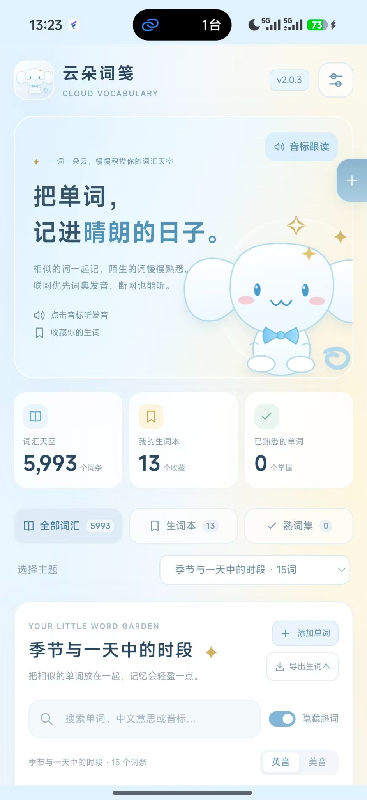
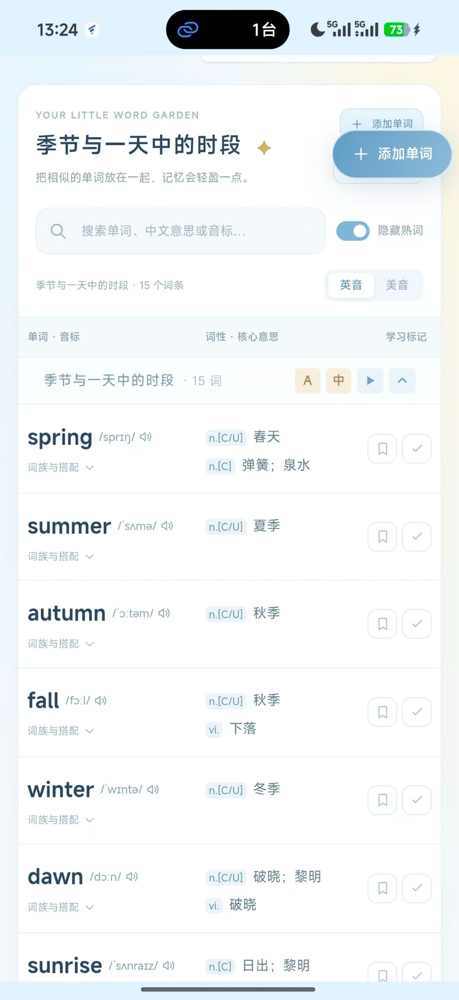
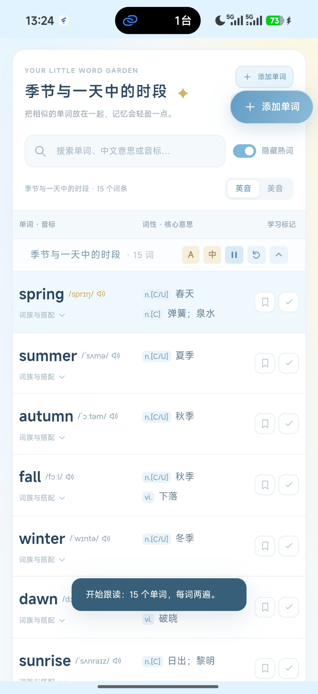
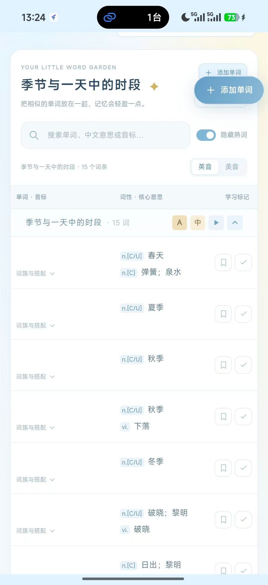
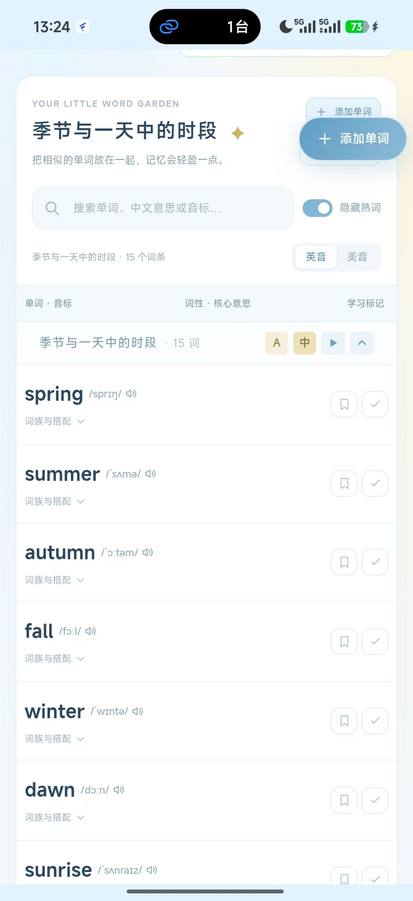
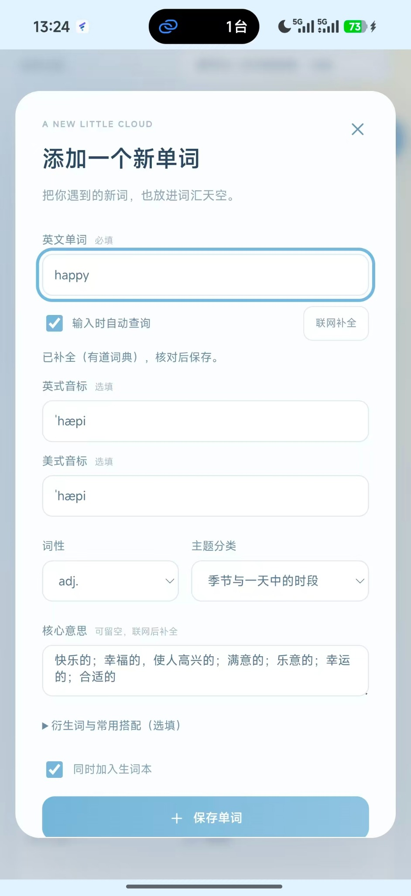
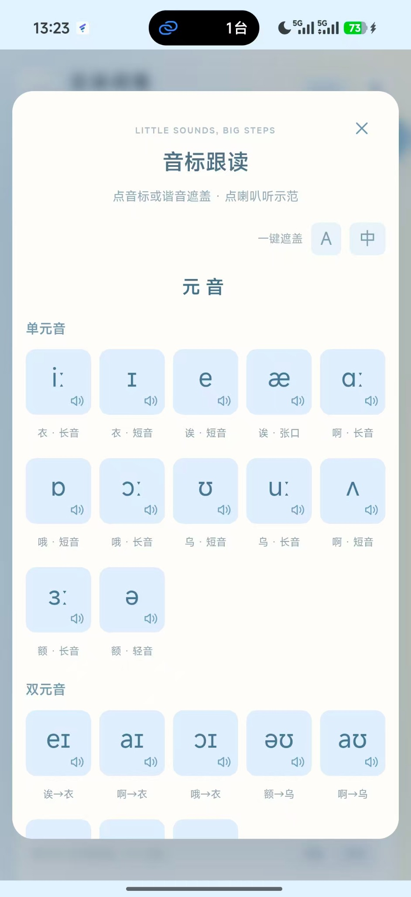
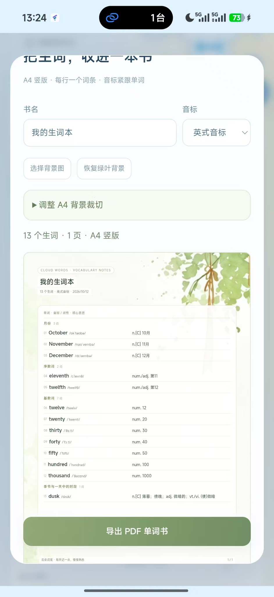

# 云朵词笺 · CloudWords

> 把单词，记进晴朗的日子。

**作者：serona**

云朵词笺是一款英语词汇学习应用，将相似主题的单词放在一起，结合发音、遮挡回忆和生词本，帮助你逐步积累词汇。提供 Android 与 Windows 版本。

## 功能截图与操作提示

以下为 Android 端截图（v2.0.3）。后续版本的界面可能有所调整。

### 1. 首页与学习概览

查看词库总数、生词收藏和已熟悉单词数量，通过主题下拉框切换学习内容。

**操作提示：** 点击「生词本」查看收藏；点击右上角「音标跟读」进入音标练习。

### 2. 主题单词表

将同一主题的单词放在一起，展示英文、音标、词性和核心中文意思，支持搜索及英美发音切换。

**操作提示：** 点击音标旁的喇叭听发音；书签用于收藏生词，勾选按钮用于标记熟词。「隐藏熟词」可减少重复复习。

### 3. 单词跟读

按主题自动播放单词，每个单词读两遍；当前朗读词条会高亮显示。

**操作提示：** 点击主题右侧的播放按钮开始；播放期间可暂停或重播，右侧折叠按钮只折叠单词内容，不影响跟读。

### 4. 遮挡英文：看中文回忆单词

隐藏英文单词及音标，保留词性与中文意思，用于主动回忆英文拼写。

**操作提示：** 点击主题旁的「A」批量遮挡或恢复英文；单击单个英文区域可独立遮挡，再点恢复。长按可复制。

### 5. 遮挡中文：看英文回忆释义

隐藏词性与中文意思，保留英文和音标，用于检验词义掌握情况。

**操作提示：** 点击主题旁的「中」批量遮挡或恢复中文；也可单独点击某个词条的中文区域进行遮挡。

### 6. 添加单词与联网补全

输入新单词后，可联网补全英美音标、词性、中文释义及词典已有的衍生词、常用搭配。

**操作提示：** 勾选「输入时自动查询」，或点击「联网补全」；核对结果后选择主题并保存，可同时加入生词本。离线添加的词条会在恢复联网后尝试补全空缺资料。

### 7. 音标跟读与遮挡练习

将元音、辅音分区展示，进一步区分单元音、双元音、清辅音和浊辅音；每行卡片数量随屏幕宽度调整。

**操作提示：** 点击喇叭听示范音；点击音标或中文谐音可分别遮挡。顶部「A / 中」用于一键遮挡或恢复。中文谐音仅作记忆提示，发音以示范音为准。

### 8. A4 生词本 PDF 导出

将收藏词条按主题整理成 A4 单词书，音标紧跟单词，中文释义统一左对齐。可自定义书名、音标类型和背景图。

**操作提示：** 选择背景后可调整 A4 裁切；预览无误后点击「导出 PDF 单词书」，选择保存位置，保存后可直接打开 PDF。所需词条与背景已在本机时可离线导出。

## 快速上手

1. 在仓库的 **Releases** 中选择适合设备的安装包：安卓下载 APK，Windows 下载 EXE。
2. 选择学习主题，点击音标旁的喇叭听单词发音。
3. 用书签收藏陌生单词，用勾选按钮标记已经熟悉的单词。
4. 使用 **A / 中** 遮挡英文或中文，进行主动回忆练习；也可以启动主题跟读，每词听两遍。
5. 将生词本导出为 PDF，或登录同一账号在手机与电脑之间同步学习记录。

## 发音与数据说明

- 联网时优先使用在线词典发音；离线时使用内置或已缓存的音频。
- 内置词条附带离线音频。新增单词需要成功缓存音频后，才能使用该词的离线录音；未缓存时会尝试设备英文语音，能否离线使用取决于设备。
- 联网补全以词典提供的内容为准，可能缺少某些音标、衍生词或搭配，保存前建议核对。
- 登录同一账号后可同步生词本、熟词标记、自定义单词和部分设置；背景图片、音频缓存等保存在各设备本机。
- 截图中的中文谐音用于辅助记忆，不代表音标的精确发音。

## 作者

**serona**

欢迎通过仓库 Issues 反馈问题或提出建议。
